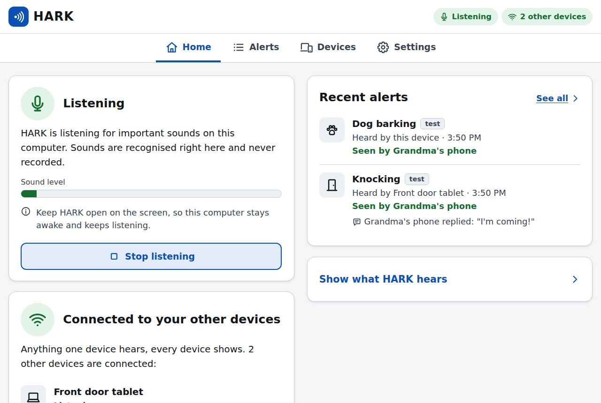
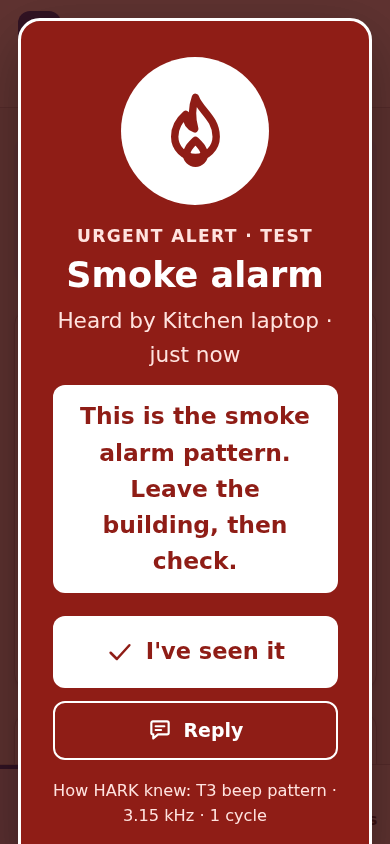
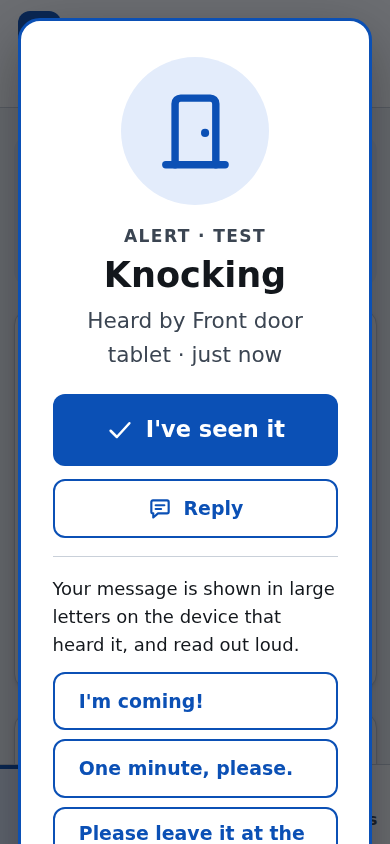
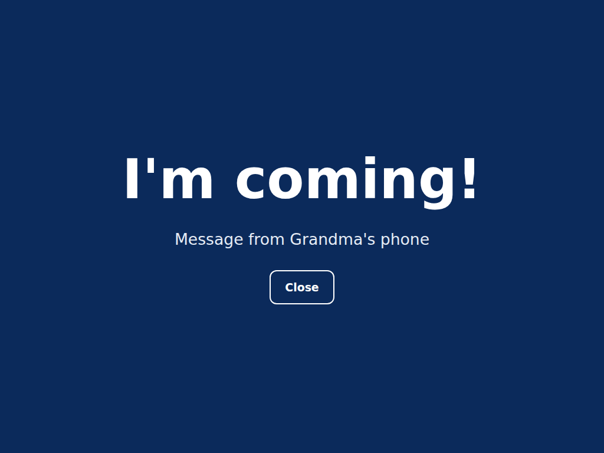

# HARK — hears important sounds for you

HARK listens for the sounds that matter: the **smoke alarm**, the **carbon monoxide alarm**, the **doorbell**,
**a knock**, **a baby crying**, **breaking glass**, **a siren**, or **someone calling your name**. When it hears
one, it alerts you with a full-screen message in large letters, a vibration pattern you can learn to recognise,
a flashing screen for urgent alarms, and a notification.

- **Every device listens and alerts on its own** — a laptop, a tablet or a phone. Out of the house, your phone
  keeps listening for you, with no Wi-Fi and no internet.
- **At home, your devices work together.** On the home Wi-Fi they join up by themselves: whatever any phone,
  tablet or computer hears, every one of them shows. One sound is one alert, even when three devices hear it,
  and "I've seen it" on one device clears it on all of them.
- **Made to be easy**, especially for older people and anyone who is Deaf or hard of hearing: large text (with
  Large and Extra large sizes), strong contrast, big buttons, four plain menu items, and one big button on every
  alert.

Sound recognition runs **on each device**. Audio is never recorded or uploaded; only the alert itself ("Knocking,
heard by the kitchen tablet") travels to your other devices, over your own home network.

| Home on a computer | An urgent alert on a phone | Replying from the phone | The reply at the door |
|---|---|---|---|
|  |  |  |  |

---

## What it does

| | |
|---|---|
| **Listens** | Google's **YAMNet** sound model (521 kinds of sound) runs in the app through **MediaPipe** WebAssembly, on a 0.975 s window every 0.5 s. |
| **Knows alarm rhythms** | Smoke alarms beep in the standard **temporal-three (T3)** pattern and CO alarms in **temporal-four (T4)**. HARK has its own detector for both, so a muffled or unusual alarm is still caught, and a microwave's three beeps cannot set off a fire alert. |
| **Alerts you** | A full-screen alert with the sound, where it was heard and what to do; one **vibration pattern per sound**; urgent alarms flash (once a second) and keep buzzing **until someone has seen them**; a notification when HARK is in the background; optionally a low 520 Hz beep. |
| **On its own** | Each device listens and alerts with no hub, no Wi-Fi and no internet (the app is stored on the device). |
| **Together at home** | Devices on the home Wi-Fi connect through a **home hub** (a computer running HARK) and share what they hear. They find each other again by themselves after a Wi-Fi drop or a day out, and an alert that happened while a phone was away shows as **missed**, not as a new alarm. Several computers can each run a hub; devices connect to all of them, so the home network keeps working when one computer leaves. |
| **Two-way** | Reply to an alert from your phone ("I'm coming!"): the device that heard the door shows it in very large letters and reads it out. A device by the door can also show visitors a sign. |
| **Learns your sounds** | "Teach HARK a sound": record your doorbell, microwave or dryer 3 times and HARK learns it on the device. |
| **Your name** | Optional: an alert when someone says your name (uses the browser's speech recognition, so it is off by default and says so). |
| **Fails loudly** | If nothing is listening anywhere in the home, every device says so in a yellow warning. A safety device must never be silently off. |

## Designed for older users

- 18 px text by default, with **Large** (21 px) and **Extra large** (24 px) in Settings; nothing runs off a small
  phone screen even at Extra large.
- Strong contrast in light and dark mode (WCAG AA everywhere, AAA for body text), and no meaning carried by
  colour alone.
- Big targets: buttons are about 58 px tall, the main ones 72 px; on phones the four-item menu (Home, Alerts,
  Devices, Settings) sits at the bottom, within reach of the thumb.
- Plain words ("I've seen it", "Not connected to other devices"), no jargon on the main screens; technical
  details are tucked away under "How HARK knew" and "Show what HARK hears".
- Works with a keyboard and a screen reader: alerts take focus, keep it, and are announced; everything behind
  an alert is inert. Respects "reduce motion" and Windows high-contrast mode.
- Checked automatically with **axe-core** on every screen, in light and dark mode, on a computer and a phone.
